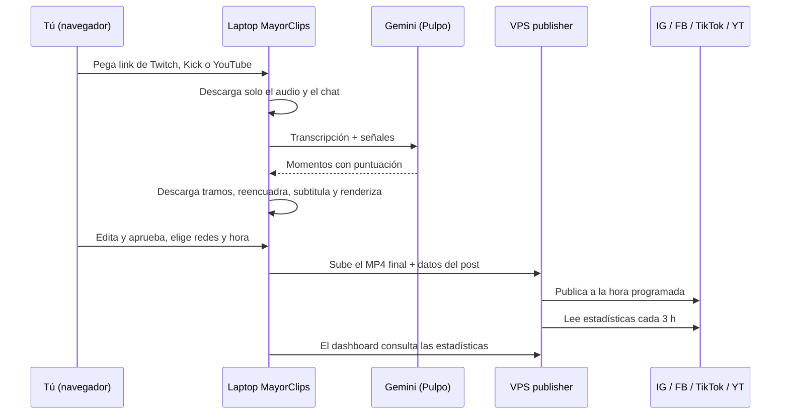
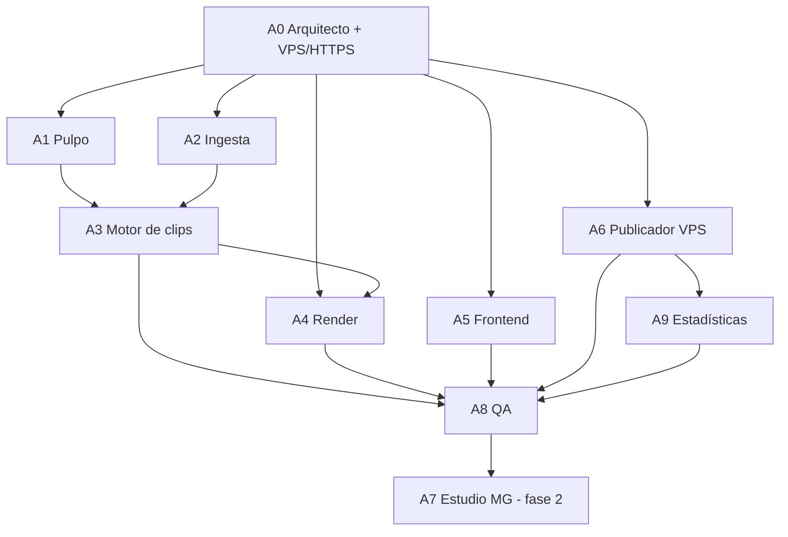

# Plan maestro v2: MayorClips (uso personal)

> Herramienta personal de clipping con IA, publicación multi-red con estadísticas y estudio de videos motion graphics hechos por código.
> Escrito para que **un equipo de agentes** lo implemente.

## Decisiones confirmadas
| Tema | Decisión |
|---|---|
| Nombre | **MayorClips** |
| Orden | **1) Clipper + Publicador + Estadísticas → 2) Estudio Motion Graphics.** El Estudio va incluido desde el diseño: tablas, rutas y pantalla reservadas. |
| APIs de IA | **Solo Gemini** (las 7 keys de JJ PAPER) + herramientas gratuitas **sin key** |
| Infraestructura | **Híbrida**: la laptop procesa y renderiza; el **VPS de JJ Paper** publica 24/7, recibe los OAuth por HTTPS y recoge las estadísticas |
| TikTok | **No se aceptan videos privados** (ver sección 6) |

---

## 0. Qué corre dónde

### 0.1 Laptop (medido)
Ryzen 5 7520U (4 núcleos / 8 hilos) · 7,33 GB de RAM (1,18 GB libres durante la prueba) · Radeon 610M de 512 MB · encoder **h264_amf funcionando** · 10 s de video vertical 1080×1920 codificado en **3,1 s**.

| Tarea | ¿Dónde? | Por qué |
|---|---|---|
| Pensar: elegir momentos, títulos, guiones, plan de escenas | ☁️ Gemini (Pulpo) | Un LLM local no cabe en 7 GB |
| Transcribir el stream **completo** (2–4 h) | ☁️ Gemini (audio) | En CPU tardaría horas |
| Subtítulos palabra por palabra **de cada clip** (15–90 s) | 💻 **Local**: faster-whisper `base`/`small` int8 | ~20–40 s por clip, ~500 MB de RAM. Precisión exacta y gratis |
| Voz IA | ☁️ edge-tts (sin key) → respaldo Gemini TTS | Gratis |
| Seguimiento de cara, recorte y render | 💻 Local (MediaPipe CPU + FFmpeg AMF + HyperFrames) | Medido: va bien |
| Publicar, programar y leer estadísticas 24/7 | 🖥️ VPS | Tiene que funcionar aunque la laptop esté apagada |

> [!IMPORTANT]
> **Sí puedes construir videos desde cero.** Que la IA no corra en tu laptop solo significa que el "cerebro" está en la nube (Gemini); las "manos" (render, edición, animación) están en tu laptop. Así funcionan también Opus Clip y compañía: nadie corre esos modelos en una laptop.

### 0.2 VPS de JJ Paper (de `DOCUMENTACION_SISTEMA_VPS_MIXNET_CEREBRO.md`)
4 GB de RAM (~600 MB en uso) · 58 GB de NVMe (~4,6 GB en uso) · PostgreSQL 16 + PostgREST + Nginx + `jj-auth`. **Es producción de JJ Paper.**

| Sí corre en el VPS | No corre en el VPS |
|---|---|
| `mayorclips-publisher` (Node o Python, ~150 MB): programador, subida a redes, refresco de tokens | Render de video (sin GPU, y le quitaría RAM al negocio) |
| Callbacks OAuth con **HTTPS** (Meta y TikTok lo exigen) | Descargas de VODs largos |
| Colector de estadísticas (cron cada 3 h) | Whisper |
| Base de datos `mayorclips_db` separada en el mismo PostgreSQL | |
| Carpeta temporal `/var/www/mc-media/` para que IG y FB descarguen el video (se borra al publicar) | |

**Reglas de convivencia con JJ Paper:** servicio systemd propio con `MemoryMax=400M` y `CPUQuota=50%`, usuario Linux propio y base de datos propia. El video temporal se borra a las 24 h. No se toca nada de `jjpaper_db`, `postgrest` ni `jj-auth`.

> [!WARNING]
> Meta y TikTok exigen **HTTPS con un dominio**; una IP sola no sirve. Hace falta un subdominio: uno de un dominio propio, o uno gratis de DuckDNS, con certificado Let's Encrypt en el Nginx existente. Es la **tarea 1 de A0**.

### 0.3 Flujo híbrido


---

## 1. Módulos
1. **Clipper IA** (fase 1)
2. **Publicador multi-red** (fase 1)
3. **Estadísticas** (fase 1)
4. **Estudio Motion Graphics** (fase 2, ya previsto en la arquitectura)
5. **Pulpo**: cerebro compartido

---

## 2. El Pulpo (solo Gemini + herramientas sin key)

Es un port a Python del pool de `JJ PAPER/assets/js/gemini-client.js` (7 keys, rotación ante 429/503), ampliado:

| Tentáculo | Uso | Key |
|---|---|---|
| Gemini Flash / Flash-Lite × 7 keys | Momentos, títulos, hooks, guiones, escenas, captions por red, corrección de HTML de HyperFrames | ✅ JJP |
| Gemini audio | Transcripción del stream completo por tramos de 10 min | ✅ JJP |
| Gemini Vision | Detectar el rectángulo de la facecam y revisar los frames renderizados | ✅ JJP |
| Gemini TTS | Voz de respaldo | ✅ JJP |
| edge-tts | Voz principal (español neutro, mexicano y otros acentos) con tiempos por palabra | Sin key |
| faster-whisper local | Subtítulos exactos de cada clip | Sin key |
| yt-dlp / chat-downloader | Fuentes y chat | Sin key |

**Reglas del Pulpo**
- **API única**: `pulpo.run(task, payload)`. Llamar directo a un proveedor está prohibido.
- **Contadores por key** (RPM, RPD y tokens) en SQLite.
  - Un 429 enfría esa key con backoff.
  - Un 503 baja a `flash-lite`.
  - Un 401 marca la key como muerta.
- **Caché por hash**: el mismo audio o prompt nunca se paga dos veces.
- **Presupuesto diario**: el Pulpo calcula cuántos streams caben en la cuota que queda y lo muestra en la UI ("Hoy te alcanza para ~N horas de stream").
- **Cola de espera**: si todas las keys están agotadas, el trabajo queda "en espera de cuota" y se reanuda solo. No se pierde nada.
- Salida JSON validada con Pydantic, con reparación automática.
- Las keys se leen de `.env` local, con el mismo formato `GEMINI_API_KEYS=[...]` de JJP. **Nunca en git.**
- **Extensible**: si mañana consigues otra key (Groq, OpenRouter…), se añade un tentáculo sin tocar el resto.

---

## 3. Clipper IA (fase 1)

1. **Ingesta audio-first**: `yt-dlp` descarga solo el audio. El chat se baja con `chat-downloader` (Twitch y YouTube); Kick va por su endpoint público, como mejor esfuerzo.
2. **Señales locales**: picos de chat (mensajes por segundo, emotes como KEKW o LUL, "clip it", "JAJAJA") y picos de audio (gritos y risas vía FFmpeg `ebur128`).
3. **Transcripción completa** con Gemini, en tramos de 10 min.
4. **Momentos**: Gemini cruza la transcripción con las señales y devuelve 10–30 candidatos `{start, end, hook, title, reason, virality_score, tags}`, de 15 a 90 s.
5. **Descarga parcial** con `yt-dlp --download-sections` solo de los momentos aprobados.
6. **Subtítulos exactos**: faster-whisper local sobre cada clip.
7. **Reencuadre 9:16**: MediaPipe a 5 fps con suavizado. Layouts:
   - facecam arriba + juego abajo
   - cara centrada
   - pantalla completa con fondo desenfocado
   - podcast de 2 personas
8. **Enriquecimiento**: título gancho, subtítulos animados, emojis, zoom en los picos, transiciones y **tarjetas de eventos** ("💀 Lo mató con 1 HP").
9. **Render**: rápido con FFmpeg o premium con HyperFrames → **Editor**.

**Repos de referencia:** ClipsAI (MIT), FunClip (MIT), auto-editor, chat-downloader (MIT). OpenShot es GPL: solo como inspiración, sin copiar código.

---

## 4. Publicador (fase 1): la verdad red por red

| Red | ¿Público? | Condiciones |
|---|---|---|
| **Instagram Reels** | ✅ **Público, normal** | Cuenta Business o Creator vinculada a una página de FB. La app de Meta en **modo desarrollador** con tu cuenta como admin publica en público sin revisión. |
| **Facebook (página)** | ✅ **Público, normal** | Mismo modo desarrollador. Publica en tu página (no en el perfil personal). |
| **TikTok** | ⚠️ Ver abajo | |
| **YouTube Shorts** (después) | ⚠️ Ver abajo | |

### 4.1 TikTok: qué pasa exactamente y cómo lo resolvemos
- **Una app sin auditar no puede publicar en público por API.** Esto es una regla de TikTok, no del plan: la "publicación directa" sale "Solo yo" y además exige que tu cuenta sea privada.
- **Tus videos NO van a quedar privados.** El plan usa estas dos vías:

| Vía | Cómo funciona | Resultado |
|---|---|---|
| **A. "Enviar a TikTok" (Upload to Inbox): por defecto, desde el día 1** | MayorClips sube el video a tu cuenta. Te llega la notificación "Tienes un video listo", lo abres y tocas **Publicar**; el caption ya va copiado. | **Público, normal** ✅. Te cuesta 1 toque en el móvil por video. No necesita auditoría. |
| **B. Publicación directa automática: se tramita en paralelo** | Se solicita la auditoría de TikTok. Requiere sitio web con política de privacidad y términos (se aloja en el VPS), video demo del flujo y cumplir sus guías de UX. | Si la aprueban, es 100 % automático y público. **Riesgo real:** TikTok puede rechazar apps de uso personal. Por eso la vía A es la base y la B es una mejora. |

> [!CAUTION]
> Nunca usaremos bots que "hagan clic" en TikTok web ni automatización con tu sesión. Eso viola sus términos y puede **banear tu cuenta**. Solo vías oficiales.

### 4.2 YouTube (fase posterior)
Un proyecto de API sin verificar sube los videos **bloqueados en privado**. Desde la fase 1 se envía gratis la **auditoría de cumplimiento de Google**. Mientras llega, YouTube queda desactivado en el publicador. La cuota da para ~6 subidas al día.

### 4.3 Funciones del publicador
- **Composer**: un post con variantes por red generadas por Gemini (caption, hashtags y límites de cada red).
- **Publicar ya / programar**: la cola vive en el **VPS**, así que publica con la laptop apagada.
- **Reintentos** automáticos, historial y aviso si un token caduca. Los tokens de Meta duran 60 días y se refrescan solos.
- Tokens cifrados (Fernet) en la base de datos del VPS.

---

## 5. Estadísticas (fase 1)

| Red | Fuente oficial | Métricas |
|---|---|---|
| Instagram | Instagram Insights API | Reproducciones, alcance, likes, comentarios, guardados, compartidos |
| Facebook | Page / Video Insights | Reproducciones, tiempo visto, reacciones |
| TikTok | Display API (`video.list`) | Vistas, likes, comentarios, compartidos |
| YouTube | Data + Analytics API (después) | Vistas, retención, likes |

- **Colector en el VPS**: cada 3 h durante la primera semana de cada video y cada 24 h después. Guarda **snapshots** para poder graficar la curva de crecimiento.
- **Dashboard estilo Quanty**: totales, vistas por red, por día y por clip, top de clips, mejor hora para publicar, y qué estilo o layout rinde más.
- **Bucle de aprendizaje**: compara la puntuación de viralidad que predijo la IA con las vistas reales. Esos datos se le dan a Gemini como ejemplos, para que cada mes elija mejores momentos.

---

## 6. Estudio Motion Graphics (fase 2, ya previsto)
Tema → guion (Gemini) → voz (edge-tts) → plan de escenas → proyecto **HyperFrames** armado con plantillas propias + bloques del registry (~450) → `hyperframes check` → auto-corrección con las skills como contexto (máx. 3 vueltas) → snapshot → render en la laptop.
Estilos: Curiosidades, Top 5, Historia/Misterio, Datos con gráficas, Reddit story.
Blender queda fuera por el hardware; para el 3D se usan los bloques Three.js de HyperFrames.

En la fase 1 ya se dejan creadas la tabla `studio_videos`, la ruta `/studio`, la pantalla y la carpeta `hf-templates/`, para que la fase 2 solo complete.

---

## 7. Frontend: estilo Quanty Clips
Colores: `abyss #060B10` · `ink #14242B` · `brand #2BF0C8` · `signal-ink #0B7355` · `mineral #F6FBF9` · texto `#E8F6F2` · bordes `white/10` · glow `rgba(43,240,200,.12)`.
Fuentes: **Sora** (títulos), **IBM Plex Sans** (texto), **IBM Plex Mono** (métricas).
Patrones: header sticky con blur, `max-w-6xl`, glow turquesa de fondo, métricas grandes en mono, estilo minimalista.
Stack: **Vite + React + Tailwind**, más ligero en RAM que Next.js.

**Pantallas:** Dashboard · Nuevo proyecto · Clips sugeridos · Editor · Publicar/Calendario · **Estadísticas** · Cuentas conectadas · Pulpo/cuota · Estudio (fase 2).

> [!NOTE]
> Los colores y fuentes vienen del CSS público de quantyclips.com. Para clonar su panel interno hacen falta capturas de pantalla (o usar `/browser`). Se replica el estilo, no la marca.

---

## 8. Arquitectura y carpetas
```
mayorclpis/
├─ backend/        FastAPI local: pulpo/, ingest/, clipper/, render/, studio/, skills/, app/
├─ publisher/      servicio del VPS: oauth/, scheduler/, uploaders/, stats/
├─ frontend/       Vite + React + Tailwind
├─ hf-templates/   plantillas HyperFrames
├─ deploy/vps/     systemd unit, bloque de Nginx, script de instalación, SQL de mayorclips_db
├─ storage/        media / renders / cache (en .gitignore, con limpieza automática)
├─ .env            GEMINI_API_KEYS, META_*, TIKTOK_*, GOOGLE_*, FERNET_KEY, VPS_API_TOKEN
└─ INICIAR-MAYORCLIPS.bat
```
- **Laptop**: SQLite para proyectos, clips y renders, más una cola de 1 worker.
- **VPS**: PostgreSQL `mayorclips_db` para cuentas, posts, programación y estadísticas.
- **Comunicación**: la laptop habla con el VPS por HTTPS con un token privado (`VPS_API_TOKEN`).

---

## 9. Riesgos (todo lo que puede salir mal)

| # | Riesgo | Prob. | Impacto | Mitigación |
|---|---|---|---|---|
| 1 | **Se acaban las cuotas gratis de Gemini** con streams largos | Alta | Medio | Audio-first, caché, presupuesto diario visible, cola "en espera de cuota", subtítulos locales con Whisper |
| 2 | **Google cambia o recorta el plan gratis de Gemini** | Media | Alto | Pulpo extensible: se añade otro proveedor sin reescribir nada |
| 3 | **La laptop se queda sin RAM** (Chrome + render) | Alta | Medio | 1 job a la vez, aviso si quedan <1,5 GB, HyperFrames con 1 worker, cerrar pestañas |
| 4 | **TikTok rechaza la auditoría** | Media | Bajo | La vía A ("Enviar a TikTok", público con 1 toque) sigue funcionando |
| 5 | **YouTube no verifica la app** | Media | Bajo | Fase posterior; mientras tanto, subida manual |
| 6 | **Meta pide revisión** o cambia permisos | Baja | Medio | Modo desarrollador para uso personal; seguir la documentación de la Graph API |
| 7 | **Token de red caducado** (60 días en Meta) | Media | Medio | Refresco automático + aviso en el dashboard |
| 8 | **yt-dlp deja de funcionar con Twitch o Kick** | Media | Alto | Botón "Actualizar yt-dlp"; respaldo con subida manual del archivo |
| 9 | **Kick sin chat replay** | Alta | Bajo | Solo con audio + transcripción funciona igual |
| 10 | **Afectar la producción de JJ Paper en el VPS** | Baja | **Muy alto** | Servicio aislado con límites de RAM y CPU, base de datos y usuario propios, sin video pesado ni renders allí |
| 11 | **Sin dominio no hay HTTPS** y los OAuth fallan | Alta | Alto | Subdominio gratis (DuckDNS) + Let's Encrypt, como tarea 1 |
| 12 | **Copyright / strikes** por clipear streams ajenos | Media | Alto | Usar contenido propio o con permiso; el sistema avisa si la fuente no es tuya |
| 13 | **Subtítulos o momentos malos** de la IA | Media | Medio | El editor deja corregir todo; bucle de aprendizaje con las estadísticas |
| 14 | **Fuga de keys o tokens** | Baja | Alto | `.env` en `.gitignore`, tokens cifrados, el VPS solo acepta un token privado |
| 15 | **Disco lleno** por los VODs | Media | Bajo | Limpieza automática de fuentes a los 7 días y de renders publicados a los 30 |

---

## 10. Plan multi-agente



| Ola | Agente | Es dueño de | "Terminado" cuando… |
|---|---|---|---|
| 1 | **A0 Arquitecto** | Estructura, `.env.example`, contrato OpenAPI, SQLite, `deploy/vps/`, subdominio + HTTPS, `mayorclips_db` | Laptop: `INICIAR-MAYORCLIPS.bat` levanta todo con mocks. VPS: `https://<subdominio>/mc/health` responde sin afectar a JJ Paper |
| 2 | **A1 Pulpo** | `backend/pulpo/` | Rota las 7 keys ante un 429 simulado, la cola de espera funciona, `/pulpo/status` muestra la cuota, tests con mocks |
| 2 | **A2 Ingesta** | `backend/ingest/` | Twitch, Kick y YouTube: audio, chat (Twitch/YT) y secciones parciales |
| 2 | **A4 Render** | `backend/render/`, `hf-templates/` | 5 estilos de subtítulos y 4 layouts; clip de 60 s en ≤2 min con AMF |
| 2 | **A5 Frontend** | `frontend/` | Todas las pantallas con el tema Quanty, conectadas a los mocks |
| 2 | **A6 Publicador** | `publisher/` (VPS) | OAuth de Meta y TikTok por HTTPS; un post sale público en IG + FB y llega al inbox de TikTok; la programación funciona con la laptop apagada; el borrador de la auditoría de TikTok y de Google está preparado |
| 3 | **A3 Motor de clips** | `backend/clipper/` | Stream de 2 h → ≥10 clips con puntuación en <15 min, reencuadre estable, subtítulos exactos |
| 3 | **A9 Estadísticas** | `publisher/stats/` + pantalla | Snapshots cada 3 h de IG, FB y TikTok, gráficos y "mejor hora" |
| 4 | **A8 QA** | `tests/`, `REVIEW.md` | E2E: link → clip → editar → programar → público en IG + FB, inbox de TikTok → estadísticas visibles. RAM pico del backend < 3 GB. VPS sin impacto en JJ Paper |
| 5 | **A7 Estudio MG** | `backend/studio/` | Tema → video vertical de 45 s con voz, subtítulos y 4+ escenas, pasa `hyperframes check` |

**Reglas para todos los agentes**
- Solo tocan su carpeta.
- Todo lo de IA pasa por `pulpo.run()`.
- Nada que exija GPU o Docker.
- En el VPS no se toca nada de JJ Paper.
- Nunca se commitean secretos.
- Cada entrega trae un script de demo + `docs/<agente>.md`.

---

## 11. Lo que tienes que hacer tú (no lo puede hacer un agente)
1. Pasar Instagram a **cuenta profesional** y vincularla a una **página de Facebook**.
2. Crear la app en **Meta for Developers** y en **TikTok for Developers** (un agente te guía paso a paso).
3. Elegir subdominio: dominio propio o DuckDNS gratis.
4. Dar acceso SSH al VPS al agente A0/A6. Los datos ya están en JJ PAPER.
5. Aprobar el envío de las auditorías de TikTok y Google.
